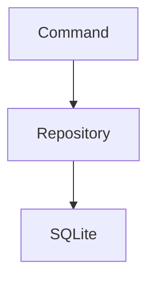
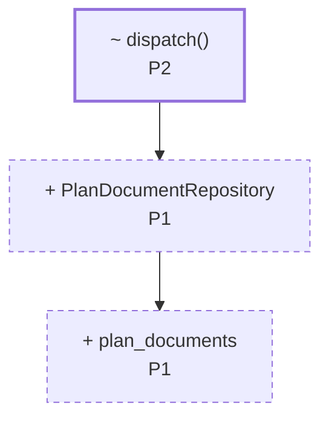
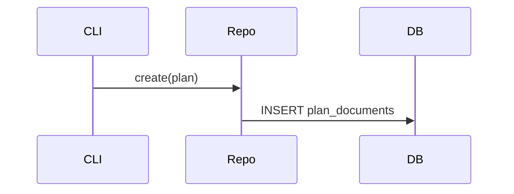
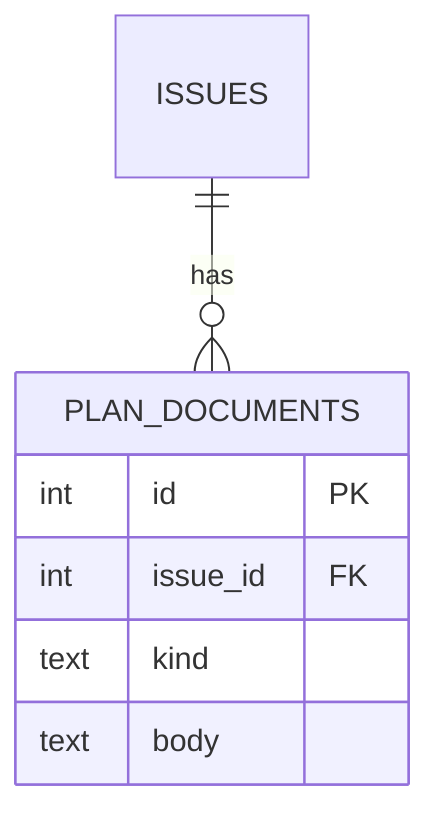

# Plan: <title>

> **Diagram convention (applies to every diagram below).** Draw the _delta_, not a
> full picture. Show unchanged components only as context, and mark every changed
> node with what happens to it and which P-item owns it:
> - `+ Name` — added, `~ Name` — modified, `- Name` — removed, unmarked — unchanged context.
> - Append the P-item id, e.g. `+ PlanDocumentRepository<br/>P1`.
> - Style the delta so it reads at a glance: `classDef new stroke-dasharray:5 4`,
>   `classDef chg stroke-width:2.5px`, and leave context nodes unstyled.
> Diagrams are **trigger-based, not mandatory**: include one only when the rule for
> its section is met. Max two diagrams per plan. Never draw a diagram that restates a
> single P-item — if the picture has one changed box, a sentence was enough.

## 1. Issue Summary
_Restate the issue in your own words and define the success criteria — what "fixed" means._

## 2. Current State
_Describe the current behavior and walk through the relevant code, noting each part's responsibility._

_Include a `mermaid` `flowchart` **only if** the change adds or moves a component,
responsibility, or dependency edge. Show the current structure here; the delta markers
land in section 3. Otherwise omit the diagram and describe the relevant code in prose._



## 3. Proposed Design
_The approach, data flow, key decisions, and alternatives considered (with why they were rejected)._

_Carry the structure and flow in diagrams here, and keep the prose for what a picture
can't show — constraints, invariants, and rejected alternatives. Use the delta
convention from the top of this file._

_Include a `flowchart` when component structure or dependencies change:_



_Include a `sequenceDiagram` — instead of or alongside the flowchart — when the call
order or control flow across layers changes:_



## 4. Planned Changes
_One entry per change item (P1, P2, …), in the same order as the mapping block. The
P-ids are the join key — diagrams, edge-case rows, verification tests, and the mapping
block all reference them, so keep them stable. For each:_
- **Purpose** — why this change is needed
- **Changes** — what will be modified, in prose. Refer to targets by id (`P1.2`)
  rather than repeating their paths and line numbers: the mapping block is the only
  place those are written.
- **Dependencies** — other P-items or work this depends on

_Every P-item described here must appear in the mapping block with the same meaning,
and every item in the block must be described here._

### Mapping block

_End this section with **exactly one** fenced block labelled `gitvibe-plan` holding
JSON in GitVibe Plan Compatibility v1 format. It is the single authoritative source
for which files and lines each P-item changes — GitVibe uses it to attribute every
hunk of the review diff to a P-item. Do not repeat its paths, operations, or
coordinates in a separate table anywhere in the plan._

_The block below is an **illustration** of the format. Its commit, paths, and
coordinates are made up; a real plan uses the target repository's data and
contains only its own block. It shows multiple targets per item (P1, P2), insertion
points (P1.2, P2.2), a binary edit (P2.3), and a rename (P3.1) whose content edits
belong to another item (P4.1)._

```gitvibe-plan
{
  "version": 1,
  "base_commit": "0123456789abcdef0123456789abcdef01234567",
  "items": [
    {
      "id": "P1",
      "description": "Add a repository for plan documents and drop the legacy plan type",
      "targets": [
        {
          "id": "P1.1",
          "path": "src/repo/plan_document.rs",
          "operation": "add",
          "scope": {"kind": "file"}
        },
        {
          "id": "P1.2",
          "path": "src/repo/mod.rs",
          "operation": "modify",
          "scope": {"kind": "point", "after": 3},
          "anchor": "module declarations"
        },
        {
          "id": "P1.3",
          "path": "src/repo/legacy_plan.rs",
          "operation": "delete",
          "scope": {"kind": "file"}
        }
      ]
    },
    {
      "id": "P2",
      "description": "Route the plan subcommand to the new repository",
      "targets": [
        {
          "id": "P2.1",
          "path": "src/cli/dispatch.rs",
          "operation": "modify",
          "scope": {"kind": "lines", "start": 120, "end": 134},
          "anchor": "fn dispatch()"
        },
        {
          "id": "P2.2",
          "path": "src/cli/dispatch.rs",
          "operation": "modify",
          "scope": {"kind": "point", "after": 8},
          "anchor": "use block"
        },
        {
          "id": "P2.3",
          "path": "docs/images/cli-help.png",
          "operation": "modify_binary",
          "scope": {"kind": "file"}
        }
      ]
    },
    {
      "id": "P3",
      "description": "Rename the plan command module to match the subcommand name",
      "targets": [
        {
          "id": "P3.1",
          "path": "src/cli/plan_cmd.rs",
          "new_path": "src/cli/plan.rs",
          "operation": "rename",
          "scope": {"kind": "file"}
        }
      ]
    },
    {
      "id": "P4",
      "description": "Make the plan command print the stored plan instead of a placeholder",
      "targets": [
        {
          "id": "P4.1",
          "path": "src/cli/plan_cmd.rs",
          "operation": "modify",
          "scope": {"kind": "lines", "start": 15, "end": 42},
          "anchor": "fn run()"
        }
      ]
    }
  ]
}
```

#### Block rules

- **`version`** — exactly the integer `1`.
- **`base_commit`** — the full 40- or 64-hex commit ID from `git rev-parse HEAD`,
  run in the **target repository** when planning starts. Never abbreviate it. Every
  path and coordinate in the block refers to the files at this commit, and the base
  stays fixed once the plan is accepted.
- **Items** — `items` is a non-empty array in display order. Each item has an `id`
  matching `P1`, `P2`, … (no leading zeros; gaps allowed), a non-blank
  `description`, and at least one target.
- **Target ids** — every target has an `id` of the form `<item id>.<n>` (`P2.1`),
  unique in the plan. Ids are identity, not position: keep a target's id while it
  describes the same work, give new targets fresh numbers, and never reuse the id of
  a dropped target.
- **Paths** — exact, case-sensitive, repository-relative, separated by `/`. No
  leading or trailing `/`, no empty, `.`, or `..` components, no glob characters
  (`*`, `?`, `[`, `]`), and no basename shortcuts for nested files. Spaces and
  Unicode are fine.
- **Operation and scope** — one of:

  | `operation` | `scope` | Meaning |
  |---|---|---|
  | `modify` | `{"kind": "lines", "start": S, "end": E}` | Replace or delete base lines `S`–`E` (1-based, inclusive, `S ≤ E`). Deleting lines from a file that stays also uses this. |
  | `modify` | `{"kind": "point", "after": A}` | Insert in the gap after base line `A`. `0` is before the first line; the file's line count is end of file. |
  | `modify_binary` | `{"kind": "file"}` | Change the content of an existing binary file. |
  | `add` | `{"kind": "file"}` | Create `path`; it must not exist at the base. |
  | `delete` | `{"kind": "file"}` | Remove `path`; it must exist at the base. |
  | `rename` | `{"kind": "file"}` | Move `path` to `new_path` (required, different, same path rules). |

- **Renames own only the path.** Edits to a renamed file's content are separate
  `modify` targets on the **original** `path`, with base coordinates — in the same
  item or another one (as P3.1 / P4.1 above). The same holds for `modify_binary`.
- **Text vs binary** — `modify` needs a text file and `modify_binary` a binary file,
  as git's diff classifies them at the base.
- **Line counting** — LF ends a line, CRLF counts as one ending, a final line without
  a newline still counts, and an empty file has zero lines. `wc -l` misses that final
  line; count with `git show <base_commit>:<path> | awk 'END { print NR }'`.
- **Distinct scopes** — give each target lines no other target claims. Overlapping
  targets in different items are allowed but make ownership of those lines
  ambiguous, and `git vibe plan check` warns about them.
- **`anchor`** — optional, non-empty: the enclosing symbol or a short quoted line,
  as context for a human reader. It never replaces coordinates.
- **Unknown fields** are allowed and ignored; object member names must be unique.

`git vibe plan check <plan-file>` checks all of the above against the repository.

## 5. Data & Interface Changes
_Schema, DB, API, or type/interface changes. Omit this section entirely when not applicable._

_Include an `erDiagram` when tables, columns, or foreign keys change, and/or a
`stateDiagram-v2` when a lifecycle or status transition changes. Apply the delta
convention — mark added/changed fields and states with `+`/`~`/`-` and the owning P-item._



## 6. Edge Cases
_Table mapping scenario → expected behavior → owning P-item._

| Scenario | Behavior | P-item |
|----------|----------|--------|
|          |          |        |

## 7. Verification
_Automated tests, each tagged with the P-item it covers (e.g. `[P1]`). Regression checks. Include GUI-only manual steps only if truly unavoidable._

## 8. Out of Scope
_What this plan deliberately does not address (non-goals)._
