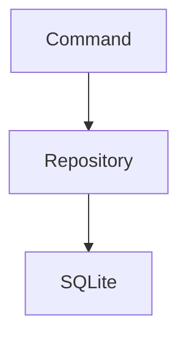
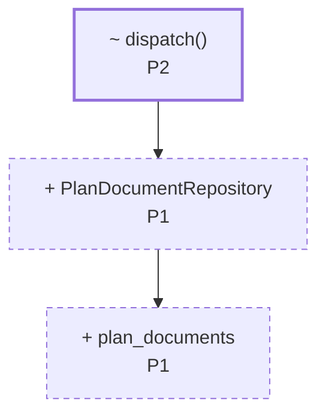
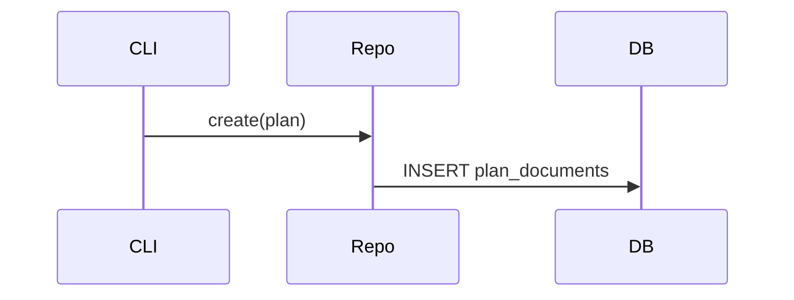
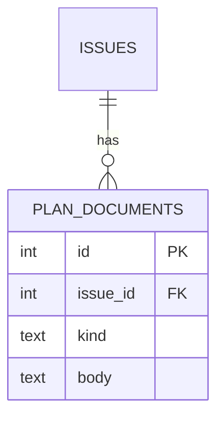

# Plan: <title>

**Base revision:** `<sha>` — every line number in this plan refers to the files at
this commit. Get it with `git rev-parse --short HEAD` before writing section 4.

> **Diagram convention (applies to every diagram below).** Draw the _delta_, not a
> full picture. Show unchanged components only as context, and mark every changed
> node with what happens to it and which P-item owns it:
> - `+ Name` — added, `~ Name` — modified, `- Name` — removed, unmarked — unchanged context.
> - Append the P-item id, e.g. `+ PlanDocumentRepository P1`.
> - Style the delta so it reads at a glance: `classDef new stroke-dasharray:5 4`,
>   `classDef chg stroke-width:2.5px`, and leave context nodes unstyled.
> Diagrams are **trigger-based, not mandatory**: include one only when the rule for
> its section is met. Max two diagrams per plan. Never draw a diagram that restates a
> single P-item — if the picture has one changed box, a sentence was enough.

## 1. Issue Summary
_Restate the issue in your own words and define the success criteria — what "fixed" means._

## 2. Current State
_Describe the current behavior and walk through the relevant code, noting each part's responsibility._

_Include a `mermaid` `flowchart` **only if** the change adds or moves a component,
responsibility, or dependency edge. Show the current structure here; the delta markers
land in section 3. Otherwise omit the diagram and describe the relevant code in prose._

## 3. Proposed Design
_The approach, data flow, key decisions, and alternatives considered (with why they were rejected)._

_Carry the structure and flow in diagrams here, and keep the prose for what a picture
can't show — constraints, invariants, and rejected alternatives. Use the delta
convention from the top of this file._

_Include a `flowchart` when component structure or dependencies change:_

_Include a `sequenceDiagram` — instead of or alongside the flowchart — when the call
order or control flow across layers changes:_

## 4. Planned Changes
_One entry per change item (P1, P2, …). The P-ids are the join key — diagrams,
edge-case rows, verification tests, and change sites all reference them, so keep them
stable. For each:_
- **Purpose** — why this change is needed
- **Changes** — what will be modified
- **Dependencies** — other P-items or work this depends on
- **Change sites** — the table below

### Change sites

Each P-item ends with a change-site table. This replaces a prose "code areas" list: it
is the machine-readable map from a diff hunk back to the P-item that owns it, so a
reader hovering over a hunk sees the right P-item even when one file carries changes
from several P-items.

| Site | File | Base lines | Op | Anchor | What changes |
|------|------|-----------|-----|--------|--------------|
| P1.1 | `src/cli/dispatch.rs` | 120–134 | modify | `fn dispatch()` | route `plan` subcommand to the new repository |
| P1.2 | `src/cli/dispatch.rs` | after 88 | insert | `use` block | import `PlanDocumentRepository` |
| P1.3 | `src/repo/plan_document.rs` | — | add file | — | new repository type |
| P1.4 | `src/repo/mod.rs` | 12–17 | delete | `struct LegacyPlan` | drop the superseded type |

Rules:

- **One row per contiguous hunk**, not one row per file. If a P-item touches three
  separate places in one file, that is three rows. Never merge distant edits into one
  wide range — that is what makes a file resolve to the wrong P-item.
- **Site ids** are `<P-id>.<n>` (`P1.1`, `P1.2`, …) and are globally unique in the plan.
- **Base lines** are line numbers in the file **at the base revision**, never predicted
  post-change numbers:
  - `modify` / `delete` — the inclusive range being replaced or removed, e.g. `120–134`.
    A single line is just `41`.
  - `insert` — `after <line>` (or `before <line>`), the base line the new code attaches to.
  - `add file` / `rename` — `—`, there is no base range.
- **Op** is one of `modify`, `insert`, `delete`, `add file`, `rename`.
- **Anchor** is the enclosing symbol (function, struct, class, config key) or a short
  quoted line. It is the fallback when the file drifts and the line numbers no longer
  match — keep it specific enough to find with a search.
- **No two sites may overlap.** If two P-items both need to touch the same lines, either
  split the range so each side owns disjoint lines, or merge the work into one P-item.
  Overlap makes the hunk → P-item mapping ambiguous.
- Verify every range before writing it — read the file at those exact lines. A guessed
  range is worse than no range, because the diff will silently attribute a hunk to the
  wrong P-item.

## 5. Data & Interface Changes
_Schema, DB, API, or type/interface changes. Omit this section entirely when not applicable._

_Include an `erDiagram` when tables, columns, or foreign keys change, and/or a
`stateDiagram-v2` when a lifecycle or status transition changes. Apply the delta
convention — mark added/changed fields and states with `+`/`~`/`-` and the owning P-item._

## 6. Edge Cases
_Table mapping scenario → expected behavior → owning P-item._

| Scenario | Behavior | P-item |
|----------|----------|--------|
|          |          |        |

## 7. Verification
_Automated tests, each tagged with the P-item it covers (e.g. `[P1]`). Regression checks. Include GUI-only manual steps only if truly unavoidable._

## 8. Out of Scope
_What this plan deliberately does not address (non-goals)._
